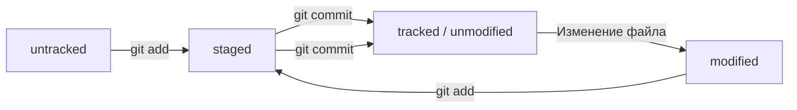

# Итоги работы

Я научился создавать локальный Git-репозиторий, связывать его с удалённым репозиторием на GitHub и проверять правильность настройки подключения.

Для подготовки этого README.md я использовал ИИ, чтобы не тратить время на ручное написание и форматирование Markdown. Это позволило сосредоточиться на изучении Git и понимании основных команд.

---

# Git — краткая шпаргалка

## 1. Основные понятия

- **Git** — система контроля версий.
- **Репозиторий** — проект, история изменений которого отслеживается Git.
- **Коммит (`commit`)** — сохранённый снимок изменений.
- **Ветка (`branch`)** — отдельная линия разработки.
- **Удалённый репозиторий (`remote`)** — репозиторий на GitHub или другом сервере.

## 2. Создание репозитория и проверка состояния

```bash
git init
git status
```

- `git init` — создаёт локальный Git-репозиторий.
- `git status` — показывает текущее состояние файлов.

## 3. Добавление и сохранение изменений

```bash
git add README.md
git add .
git commit -m "Описание изменений"
```

- `git add` — добавляет изменения в подготовленную область.
- `git add .` — добавляет все изменения в текущей директории и её поддиректориях.
- `git commit` — сохраняет подготовленные изменения в истории.

## 4. Подключение GitHub

```bash
git remote add origin git@github.com:USERNAME/REPOSITORY.git
git remote -v
git remote set-url origin git@github.com:USERNAME/REPOSITORY.git
```

- `git remote add origin` — подключает удалённый репозиторий.
- `git remote -v` — показывает адреса удалённого репозитория.
- `git remote set-url` — изменяет адрес уже настроенного удалённого репозитория.

Вместо `USERNAME` и `REPOSITORY` нужно указать имя пользователя GitHub и название репозитория.

## 5. Отправка изменений на GitHub

```bash
git push -u origin master
git push
```

- `git push` — отправляет локальные коммиты в удалённый репозиторий.
- `-u origin master` — устанавливает связь локальной ветки `master` с удалённой веткой, чтобы в дальнейшем было достаточно команды `git push`.

Если основная ветка называется `main`, вместо `master` нужно использовать `main`.

## 6. Получение изменений

```bash
git pull
git fetch
```

- `git pull` — получает изменения с удалённого репозитория и интегрирует их в текущую ветку.
- `git fetch` — получает информацию об удалённых изменениях, не объединяя их автоматически с текущей веткой.

## 7. Работа с ветками

```bash
git branch
git branch feature
git switch feature
git switch -c feature
git merge feature
```

- `git branch` — показывает локальные ветки.
- `git branch feature` — создаёт ветку `feature`.
- `git switch feature` — переключается на существующую ветку.
- `git switch -c feature` — создаёт новую ветку и переключается на неё.
- `git merge feature` — объединяет изменения указанной ветки с текущей.

## 8. Просмотр изменений и истории

```bash
git log --oneline
git diff
git diff --staged
```

- `git log --oneline` — показывает краткую историю коммитов.
- `git diff` — показывает изменения, которые ещё не добавлены в подготовленную область.
- `git diff --staged` — показывает подготовленные изменения.

## 9. Отмена изменений

```bash
git restore README.md
git restore --staged README.md
```

- `git restore README.md` — отменяет незакоммиченные изменения файла в рабочей директории.
- `git restore --staged README.md` — убирает файл из подготовленной области, сохраняя его изменения в рабочей директории.

> **Важно:** команды отмены могут привести к потере изменений. Перед их использованием стоит проверить состояние репозитория.

## 10. Типичный рабочий процесс

```bash
git status
git add .
git commit -m "Описание изменений"
git push
```

1. Проверить состояние файлов.
2. Добавить нужные изменения.
3. Создать коммит.
4. Отправить коммит на GitHub.

## 11. Полезные советы

- Перед коммитом проверяй `git status`.
- Пиши понятные сообщения коммитов.
- Не добавляй в репозиторий пароли, токены и другие секретные данные.
- Проверяй адрес удалённого репозитория командой `git remote -v`.
- После отправки изменений убедись, что они появились на GitHub.

## 12. Хеш коммита

Каждый коммит в Git имеет уникальный хеш — идентификатор, по которому его можно найти в истории изменений.

```bash
git log
git log --oneline
```

- `git log` — показывает историю коммитов с подробной информацией.
- `git log --oneline` — показывает историю в сокращённом формате: хеш и сообщение коммита.

Пример:

```text
18f0822 dobavil_readme
```

`18f0822` — сокращённый хеш коммита, `dobavil_readme` — сообщение коммита.

## 13. HEAD

`HEAD` — указатель на текущую позицию в истории Git. Обычно он указывает на последний коммит текущей ветки.

Посмотреть последний коммит можно командой:

```bash
git log -1
```

Пример:

```text
18f0822 (HEAD -> master) dobavil_readme
```

- `HEAD` — текущая позиция в истории.
- `master` — текущая ветка.
- `18f0822` — хеш коммита.

## 14. Статусы файлов в Git

Git использует статусы, чтобы показывать, какие файлы отслеживаются и какие изменения подготовлены к коммиту.

- **`untracked`** — новый файл, который Git ещё не отслеживает.
- **`modified`** — отслеживаемый файл изменён.
- **`staged`** — изменения добавлены в подготовленную область и готовы к коммиту.
- **`unmodified`** — файл не изменён с момента последнего коммита.

Проверить статусы файлов можно командой:

```bash
git status
```

### Жизненный цикл файла



После коммита подготовленные изменения сохраняются в истории. Если затем изменить отслеживаемый файл, он перейдёт в состояние `modified`. Команда `git add` снова подготовит изменения к коммиту.

## 15. Оформление сообщений к коммитам

Сообщение коммита должно кратко и понятно описывать внесённые изменения.

Примеры:

```bash
git commit -m "Добавить раздел про HEAD"
git commit -m "Дополнить информацию про git log"
git commit -m "Описать статусы файлов"
git commit -m "Добавить схему жизненного цикла файлов"
```

Рекомендации:

- Использовать короткие и информативные формулировки.
- Указывать, что именно было добавлено или изменено.
- Использовать ключевые слова из названия урока.
- Избегать слишком общих сообщений, например `update`, `изменения` или `test`.
